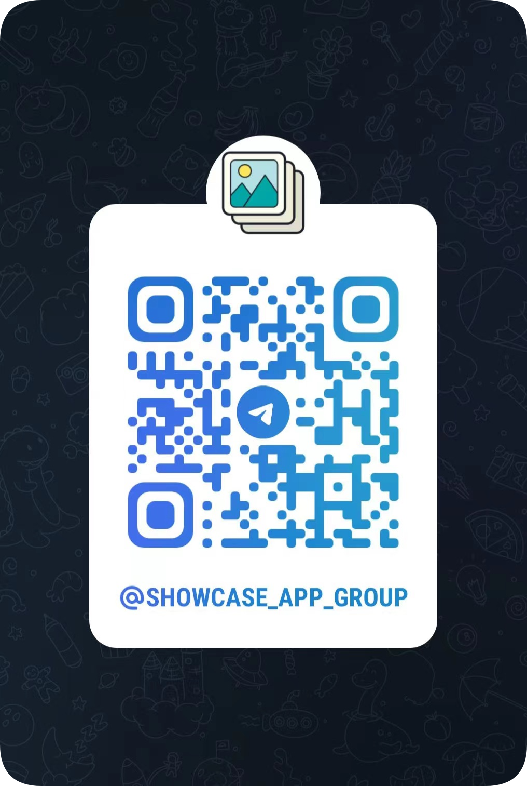

# Download

Android version is on Google Play, and install packages are also available on GitHub Releases. iOS version is still on TestFlight. The feature guide is on the [home page](/).

## Telegram group

## WeChat group

- [Donate](/donate)
- [Privacy policy](/privacypolicy)
- [Terms and conditions](/termsconditions)
- [Telegram group](https://t.me/showcase_app_group)
