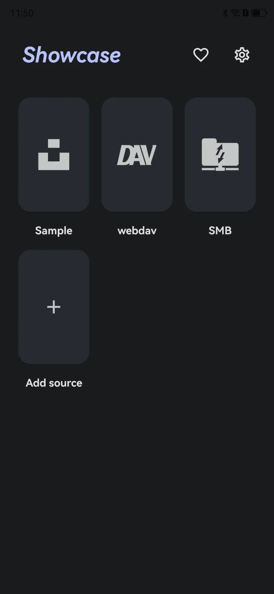
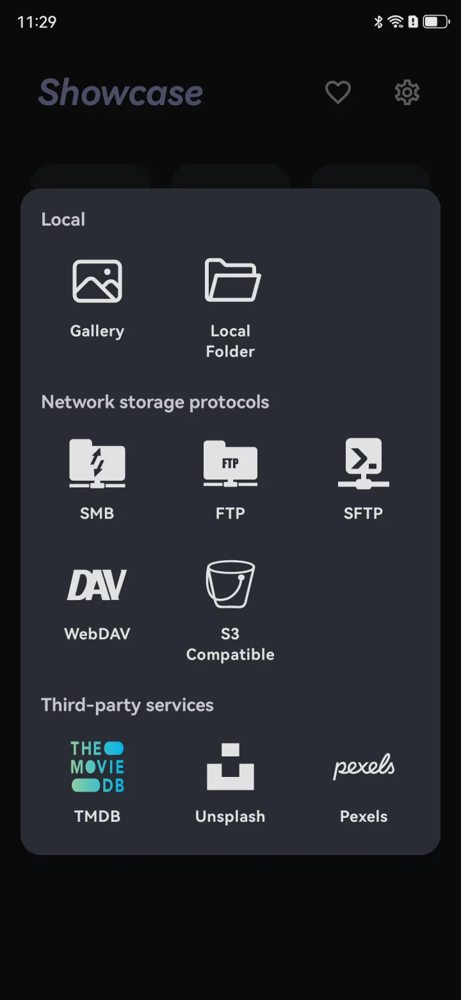
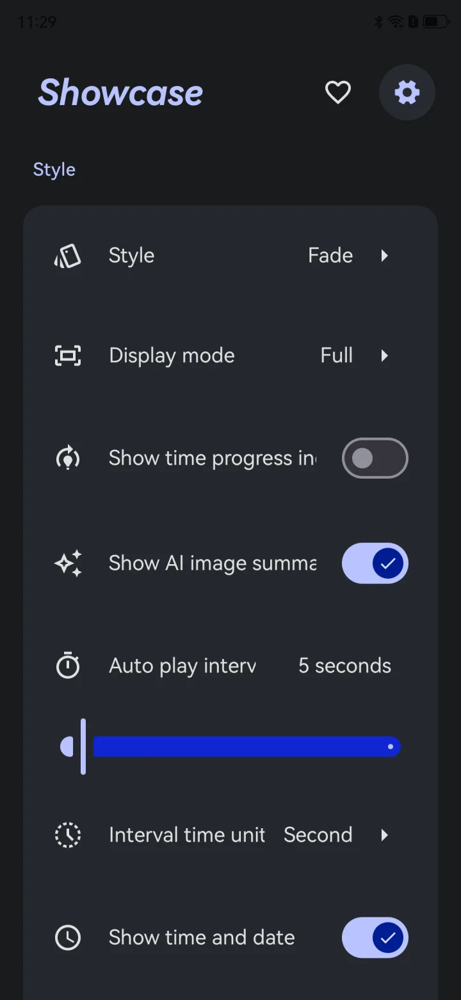
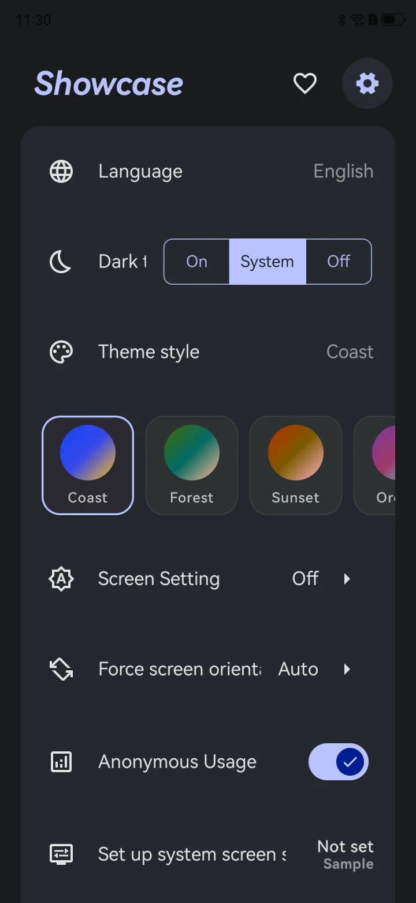

## Preview

  
  
  
  

<video class="home-video" src="./images/app/style-picker.mp4" poster="./images/app/style-picker-poster.webp" width="1280" height="576" controls muted loop playsinline preload="none" aria-label="Screen recording of the display styles"></video>

<video class="home-video" src="./images/app/playback.mp4" poster="./images/app/playback-poster.webp" width="1280" height="590" controls muted loop playsinline preload="none" aria-label="Screen recording of slideshow playback with AI summaries and weather"></video>

